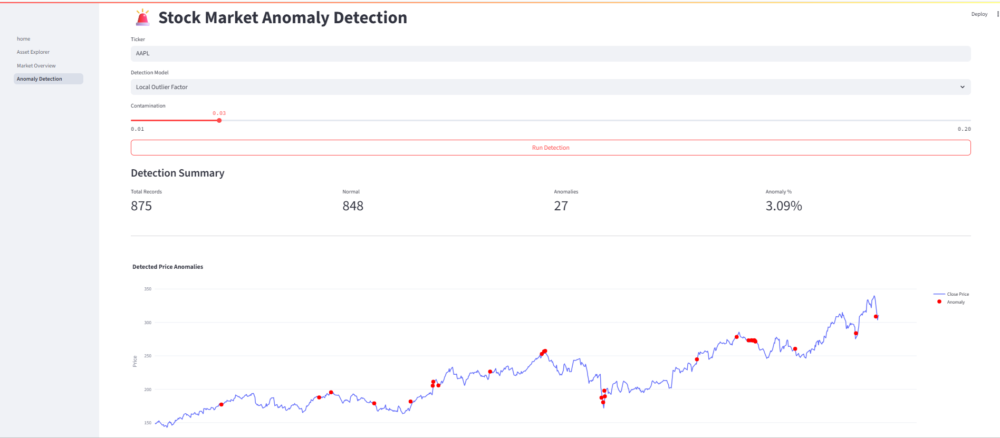

# 🚀 Getting Started
## Preview App

<p align="center">
  
</p>

## Prerequisites

* Python **3.11** or later
* Git

---

## Installation

### 1. Clone the repository

```bash
git clone https://github.com/yourusername/stock-market-anomaly-detection.git

cd stock-market-anomaly-detection
```

### 2. Create a virtual environment (Recommended)

**Windows**

```bash
python -m venv .venv

.venv\Scripts\activate
```

**Linux / macOS**

```bash
python -m venv .venv

source .venv/bin/activate
```

### 3. Install dependencies

```bash
pip install -r requirements.txt
```

### 4. Launch the application

```bash
streamlit run home.py
```

The application will automatically open in your default browser.

---

# 📖 Application Guide

StockVision currently consists of **three interactive pages** that guide users from exploring market data to detecting anomalous market behavior.

---

# 📊 Page 1 — Asset Explorer

The **Asset Explorer** is the starting point of the application.

Its purpose is to download and visualize historical market data before performing any analysis.

## Features

* Select stock ticker
* Select market (US / Indonesia)
* Choose historical date range
* Download historical data from Yahoo Finance
* Interactive candlestick chart
* Trading volume visualization
* Historical price table

## How to Use

1. Open **Asset Explorer** from the sidebar.
2. Select the desired market.
3. Choose a stock ticker.
4. Select the start and end dates.
5. Click **Load Data**.

The application will display:

* Latest market price
* OHLC information
* Candlestick chart
* Volume chart
* Historical dataset

This page allows users to verify that the downloaded market data is correct before proceeding with technical analysis.

---

# 📈 Page 2 — Market Overview & Technical Indicators

After downloading the historical data, this page performs **feature engineering** by generating commonly used technical indicators.

These engineered features become the input variables for anomaly detection.

## Generated Features

### Price Features

* Daily Return
* Log Return
* Moving Average (20)
* Moving Average (50)
* Moving Average (200)

### Momentum Indicators

* Relative Strength Index (RSI)
* MACD
* Commodity Channel Index (CCI)
* Average Directional Index (ADX)

### Volatility Indicators

* Bollinger Bands
* Rolling 20-Day Volatility

## Charts

The dashboard contains several interactive visualizations.

### Price Analysis

* Stock Price with Moving Averages
* Bollinger Bands

### Momentum Indicators

* Relative Strength Index (RSI)
* MACD
* Commodity Channel Index (CCI)
* Average Directional Index (ADX)

### Risk Analysis

* Rolling Volatility

### Feature Dataset

Displays the engineered dataset that will be used by the anomaly detection models.

---

# 🚨 Page 3 — Anomaly Detection

The anomaly detection page identifies unusual stock market behavior using unsupervised machine learning algorithms.

Current supported models:

* Isolation Forest
* Local Outlier Factor (LOF)

Additional models such as One-Class SVM, DBSCAN, and AutoEncoder are planned for future releases.

---

## Model Configuration

Users can configure several parameters before running the detection model.

### Stock Ticker

Specify the stock symbol to analyze.

Example:

```
AAPL
MSFT
NVDA
BBCA.JK
BBRI.JK
```

### Detection Model

Select one of the available anomaly detection algorithms.

* Isolation Forest
* Local Outlier Factor (LOF)

### Contamination

The contamination parameter estimates the proportion of anomalous observations in the dataset.

Typical values:

| Contamination | Description                                    |
| ------------- | ---------------------------------------------- |
| 0.01          | Very conservative (approximately 1% anomalies) |
| 0.03          | Recommended default                            |
| 0.05          | Moderate anomaly detection                     |
| 0.10          | Aggressive anomaly detection                   |

Increasing the contamination value causes the model to classify more observations as anomalies.

---

## Running the Model

1. Select the stock ticker.
2. Choose the anomaly detection algorithm.
3. Adjust the contamination parameter if necessary.
4. Click **Run Detection**.

The application automatically:

1. Downloads historical stock data.
2. Generates technical indicators.
3. Selects the engineered features.
4. Trains the selected anomaly detection model.
5. Predicts anomalous observations.
6. Displays the detection results.

---

## Detection Summary

After the model finishes, a summary dashboard is displayed.

Metrics include:

* Total Records
* Normal Observations
* Detected Anomalies
* Percentage of Anomalies

These metrics provide a quick overview of the model's output.

---

## Anomaly Visualization

Detected anomalies are plotted directly on the stock price chart.

* Blue line represents the historical closing price.
* Red markers indicate observations classified as anomalies.

This visualization helps users quickly identify abnormal market movements over time.

---

## Anomaly Table

All detected anomalies are displayed in a table containing the relevant market information.

Depending on the selected features, the table may include:

* Date
* Close Price
* Volume
* Daily Return
* RSI
* MACD
* Volatility
* Anomaly Score

This table enables users to inspect individual anomalous observations in detail.

---

## Export Results

Users can download the anomaly detection results as a CSV file for further analysis.

---

# 🧠 Current Machine Learning Pipeline

The current workflow of StockVision is illustrated below.

```
Historical Stock Data
          │
          ▼
Data Cleaning
          │
          ▼
Feature Engineering
          │
          ▼
Technical Indicators
          │
          ▼
Anomaly Detection Model
          │
          ▼
Anomaly Prediction
          │
          ▼
Interactive Visualization
          │
          ▼
CSV Export
```

---

# 📌 Current Project Status

### Completed

* Historical market data downloader
* Asset Explorer
* Technical indicator generation
* Interactive financial charts
* Isolation Forest implementation
* Local Outlier Factor implementation
* Anomaly visualization
* CSV export

### Planned Features

* One-Class SVM
* DBSCAN
* AutoEncoder
* Root Cause Analysis
* SHAP Explainability
* Model Comparison Dashboard
* Portfolio-Level Anomaly Detection
* News Sentiment Integration
* PDF Report Generation
* Real-Time Market Monitoring
